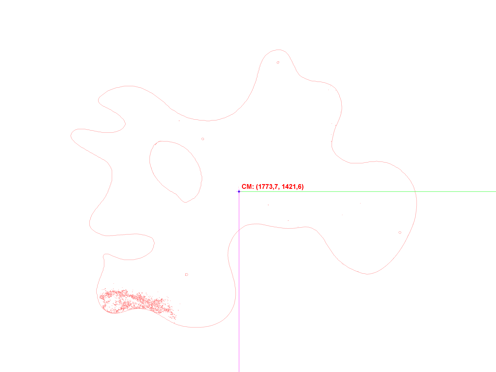
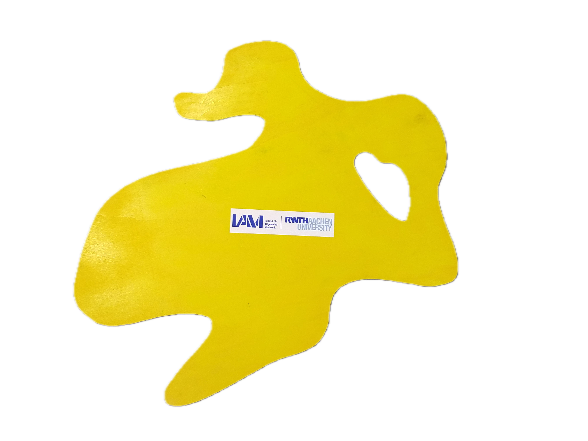

Projekt zur Berechnung des Schwerpunktes und des Statischen Moments der IAM Amöben.

# Tools benutz
- MacBook -> zur entfernung der Bild hintergründe
- StackOverflow -> Code hilfen
- Java -> Programiersprache meiner Wahl
- Ai -> zur Hilfe mit teilen des Codes, darunter die ganze CSV und teile der Visuellen Asugabe, da diese Felder sind die ich vorher nicht benutz habe

  # Hinweise

  Der berechnete Schwerpunkt und das Statische Momentum ist nur eine annäherung, da hier mehrere Probelem auftreten.
  
  Einerseits muss ich drauf hoffen das die Amöben richtug ausgeschnitten worden sind, was bei der einen schonmal etwas schiefgelaufen ist.
  Dazu kommt das Gewicht vom sticker wurde mit 1.01 bewertet, die Fäche wurde mit 1 bewertet in der Rechnung, dies soll die genauikgeit leicht erhöhen.
  Da die Bilder wahrscheinlich keinem Perfekten 90° Winkel entsprechen verzeht dieses nochmals die Berechnungen etwas.

  Bei dem Statischen Moment wird vom Mittelpunkt des Scwhwerpunktes ausgegangen, und diese werden in pixel^2 angegeben.

# Ergebnisse

#Amöbe 1

Ausgeschnittene Bild:

Bild mit Outline, bewerteter Masse, Schwerbunkt und Momentum

Hinweis: Wie zu sehen ist ist die Berechnung nicht perfekt da hier ein großer Teil unten links fehlerhaft ausgeschnitten wurde und somit nicht mit berechnet wurde.

Schwerpunkt liegt bei: (1763,228; 1432,014)

Statische Momente:

x: 1.0966998437897742E12 p^2  
y: 5.649790519876921E11 p^2

#Amöbe 2

Ausgeschnittene Bild:

Bild mit Outline, bewerteter Masse, Schwerbunkt und Momentum

Schwerpunkt liegt bei:(1838,249; 1521,855)

Statische Momente:

x: 1.372754036956749E12 p^2  
y: 1.0177687445093416E12 p^2

Runtime Optimierungen haben das Prokekt von 12 auf unter 3 Sekunden gebracht

  
